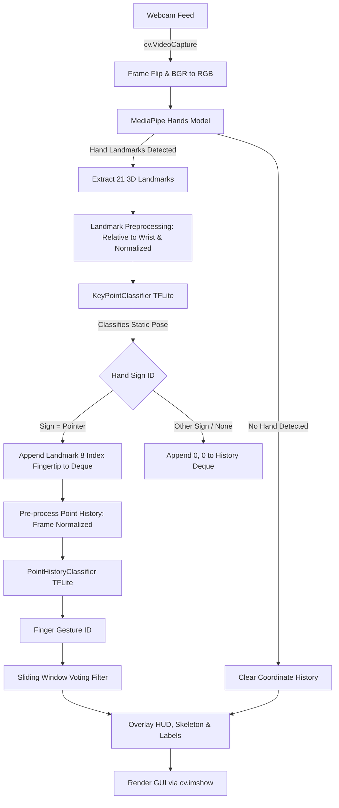
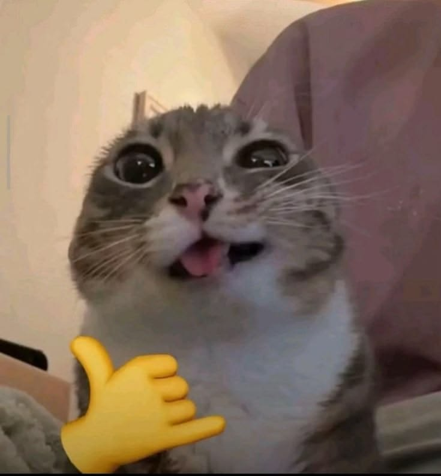
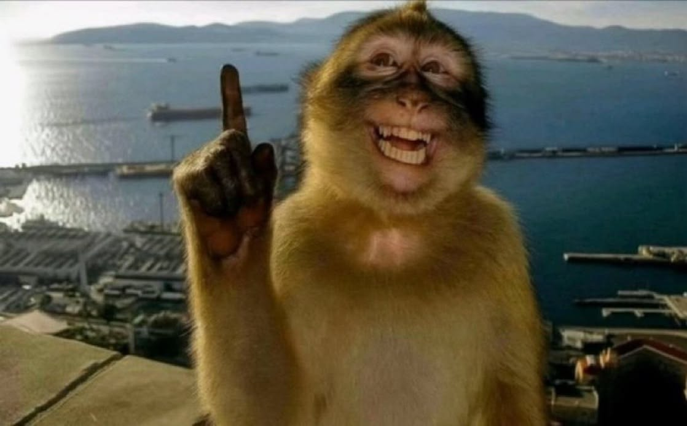
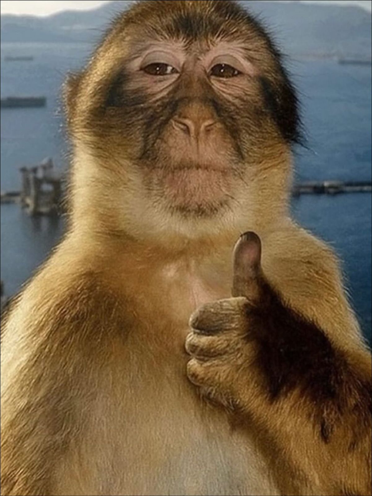
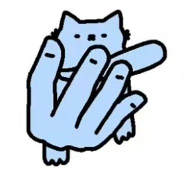
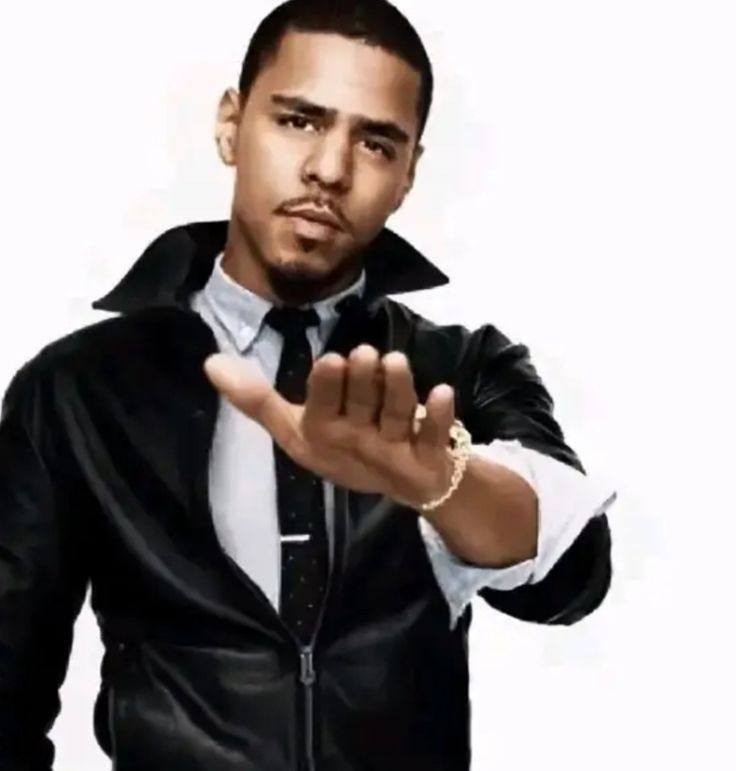
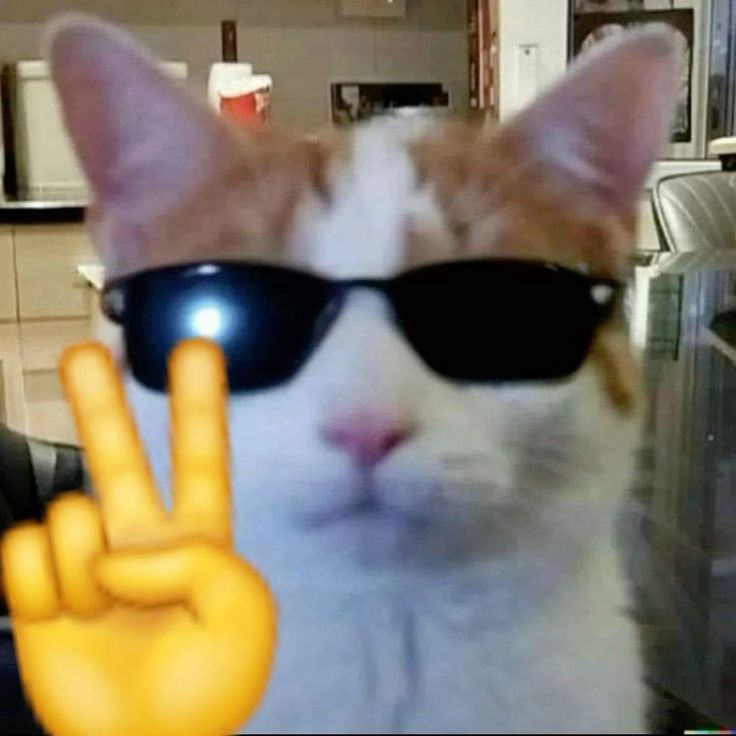

# Comprehensive Technical Breakdown: Hand Gesture Recognition Using MediaPipe & TensorFlow Lite

## 1. Executive Summary

This project delivers a real-time computer vision and machine learning pipeline capable of detecting human hands, estimating 3D skeletal landmarks, and classifying both **static hand signs** and **dynamic finger gestures**. 

Operating entirely on CPU with sub-millisecond neural network inference, the architecture blends **Google MediaPipe Hands** for robust landmark detection with compact **Multi-Layer Perceptron (MLP)** models deployed via **TensorFlow Lite (TFLite)**. 

### Core Capabilities
- **Static Hand Pose Recognition**: Real-time classification of hand formations (e.g., *Open Hand*, *Closed Fist*, *Pointing Finger*).
- **Dynamic Gesture Recognition**: Temporal tracking and sequence classification of index fingertip motion over a 16-frame sliding window (e.g., *Clockwise Rotation*, *Counter-Clockwise Rotation*, *Linear Movement*, *Stationary/Stop*).
- **Interactive Dataset Collection**: Built-in keyboard-driven logging pipeline to record new training samples directly from live webcam video.
- **Lightweight Edge Inference**: Quantized `.tflite` models executed with minimal CPU/memory footprint, suitable for embedded systems, robotics, and edge devices.

---

## 2. Technology Stack & Ecosystem

| Layer | Component | Version Range | Purpose |
| :--- | :--- | :--- | :--- |
| **Runtime** | Python | `3.8` - `3.12` | Core programming language |
| **Vision Framework** | Google MediaPipe | `>= 0.8.4` (0.10+ on Python 3.12) | High-fidelity 21 3D hand landmark localization |
| **Image Processing** | OpenCV (`opencv-python`) | `>= 4.6.0` | Video capture, frame transforms, rendering overlays |
| **Deep Learning** | TensorFlow / Keras | `>= 2.9.0` | Neural network construction, training, and evaluation |
| **Edge Deployment** | TensorFlow Lite (`tf.lite`) | Built-in | Sub-millisecond quantization & CPU inference |
| **Vector Math** | NumPy | `>= 1.20.0` | Coordinate transformations, array slicing, normalizations |
| **Data & Metrics** | Scikit-learn | `>= 1.0.2` | Dataset splitting, confusion matrix computation |
| **Visualization** | Matplotlib / Seaborn | `>= 3.5.0` | Loss curves, training accuracy, confusion matrix heatmaps |
| **Containerization** | Docker | Latest | Reproducible, platform-independent runtime |

---

## 3. Directory Structure & File Breakdown

```
ML-hand-gesture/
│
├── app.py                                # Main application & interactive live pipeline
├── keypoint_classification.ipynb         # Hand sign model training & TFLite export
├── point_history_classification.ipynb    # Finger motion model training & TFLite export
├── requirements.txt                      # Project dependencies
├── Dockerfile                            # Docker container configuration
├── .dockerignore                         # Docker build exclusions
├── .gitignore                            # Git repository ignores
├── LICENSE                               # Apache 2.0 open-source license
├── CITATION.cff                          # Academic/code citation metadata
├── README.md                             # English project documentation
├── README_JA.md                          # Original Japanese documentation
├── PROJECT_BREAKDOWN.md                  # Comprehensive technical specification
│
├── model/                                # Machine learning models and inference code
│   ├── __init__.py                       # Package initializer exposing classifiers
│   │
│   ├── keypoint_classifier/              # Static Hand Sign Classifier
│   │   ├── keypoint.csv                  # Dataset: Class ID + 42 normalized coordinates
│   │   ├── keypoint_classifier.hdf5      # Saved Keras model checkpoint
│   │   ├── keypoint_classifier.tflite    # Quantized TFLite production model
│   │   ├── keypoint_classifier_label.csv # Human-readable class labels
│   │   └── keypoint_classifier.py        # Python TFLite inference wrapper class
│   │
│   └── point_history_classifier/         # Dynamic Finger Motion Classifier
│       ├── point_history.csv             # Dataset: Class ID + 32 historical coordinates
│       ├── point_history_classifier.hdf5 # Saved Keras model checkpoint
│       ├── point_history_classifier.tflite # Quantized TFLite production model
│       ├── point_history_classifier_label.csv # Human-readable motion class labels
│       └── point_history_classifier.py   # Python TFLite inference wrapper class
│
└── utils/                                # Helper utilities
    ├── __init__.py                       # Package initializer
    └── cvfpscalc.py                      # Moving-average FPS calculation class
```

### Detailed File Responsibilities

#### `app.py`
The primary execution script. Initializes the webcam, configures MediaPipe Hands, invokes pre-processing functions, dispatches coordinates to the inference models, manages interactive keyboard input, logs training datasets, and renders visual overlays.

#### `model/keypoint_classifier/keypoint_classifier.py`
Encapsulates `tf.lite.Interpreter` for static hand sign classification.
- **Input**: 42 normalized relative coordinates (`float32`).
- **Output**: Integer class index (`0`: Open, `1`: Close, `2`: Pointer).

#### `model/point_history_classifier/point_history_classifier.py`
Encapsulates `tf.lite.Interpreter` for dynamic trajectory classification.
- **Input**: 32 normalized fingertip relative coordinates (`float32`).
- **Output**: Integer class index (`0`: Stop, `1`: Clockwise, `2`: Counter Clockwise, `3`: Move). Includes confidence thresholding (`score_th=0.5`).

#### `utils/cvfpscalc.py`
Maintains a moving window deque of frame deltas using OpenCV's `cv.getTickCount()` and `cv.getTickFrequency()` to compute smooth, jitter-free real-time FPS metrics.

---

## 4. End-to-End System Pipeline



### 1. Video Capture & Preprocessing
1. Frame is captured via OpenCV `cv.VideoCapture(device_id)`.
2. Mirrored horizontally (`cv.flip(image, 1)`) to ensure intuitive user interaction.
3. Converted from BGR to RGB color space as expected by MediaPipe.

### 2. MediaPipe Hand Landmark Detection
MediaPipe detects up to 21 anatomical landmarks per hand in normalized screen coordinates $(x, y, z \in [0.0, 1.0])$.
- Landmark `0`: Wrist
- Landmarks `1-4`: Thumb (CMC, MCP, IP, TIP)
- Landmarks `5-8`: Index finger (MCP, PIP, DIP, TIP)
- Landmarks `9-12`: Middle finger (MCP, PIP, DIP, TIP)
- Landmarks `13-16`: Ring finger (MCP, PIP, DIP, TIP)
- Landmarks `17-20`: Pinky finger (MCP, PIP, DIP, TIP)

### 3. Landmark Coordinate Normalization (Keypoint Normalization)
To achieve translation and scale invariance:
1. **Wrist Centering (Translation Invariance)**: The $(x, y)$ coordinate of landmark `0` (wrist) is subtracted from all 21 landmarks:
   $$x'_i = x_i - x_0, \quad y'_i = y_i - y_0 \quad \text{for } i \in [0, 20]$$
2. **Flattening**: The paired coordinates are flattened into a 1D vector of length $42$:
   $$V = [x'_0, y'_0, x'_1, y'_1, \dots, x'_{20}, y'_{20}]$$
3. **Max-Magnitude Scaling (Scale Invariance)**:
   $$M = \max_{j} (|V_j|)$$
   $$V_{\text{norm}} = \left[ \frac{V_0}{M}, \frac{V_1}{M}, \dots, \frac{V_{41}}{M} \right]$$

### 4. Point History Pipeline (Dynamic Gesture Normalization)
1. When the classified hand sign is `Pointer` (ID: 2), the pixel position of landmark `8` (index fingertip) is appended to a fixed-size `deque(maxlen=16)`.
2. When any other pose is detected or tracking is lost, `[0, 0]` is logged.
3. Preprocessing converts coordinates relative to the initial point in history and normalizes by camera width and height:
   $$hx'_i = \frac{hx_i - hx_0}{\text{width}}, \quad hy'_i = \frac{hy_i - hy_0}{\text{height}}$$
4. Flattened into a 32-element vector fed to `PointHistoryClassifier`.

### 5. Temporal Smoothing & Jitter Reduction
A sliding buffer `finger_gesture_history = deque(maxlen=16)` stores recent predictions. The system selects the mode via `Counter(finger_gesture_history).most_common()`, eliminating transient noise and false positives.

---

## 5. Machine Learning Architectures

### Hand Sign Classifier (`KeyPointClassifier`)
- **Input Dimension**: 42 features
- **Type**: Multi-Layer Perceptron (MLP)
- **Model Topology**:
  - `InputLayer(shape=(42,))`
  - `Dropout(rate=0.2)`
  - `Dense(20, activation='relu')`
  - `Dropout(rate=0.4)`
  - `Dense(10, activation='relu')`
  - `Dense(NUM_CLASSES, activation='softmax')`
- **Total Parameters**: ~1,103
- **Inference Latency**: < 0.2 ms on standard modern CPUs.

### Finger Gesture Classifier (`PointHistoryClassifier`)
- **Input Dimension**: 32 features (16 timesteps $\times$ 2 coordinates)
- **Default Topology (MLP)**:
  - `InputLayer(shape=(32,))`
  - `Dropout(rate=0.2)`
  - `Dense(24, activation='relu')`
  - `Dropout(rate=0.5)`
  - `Dense(10, activation='relu')`
  - `Dense(NUM_CLASSES, activation='softmax')`
- **Total Parameters**: ~1,086
- **Alternative Topology (LSTM)**:
  - `Reshape((16, 2))`
  - `Dropout(0.2)`
  - `LSTM(16)`
  - `Dropout(0.5)`
  - `Dense(10, activation='relu')`
  - `Dense(NUM_CLASSES, activation='softmax')`

---

## 6. Interactive Keyboard Controls & Modes

When `app.py` is running, the following keyboard inputs control behavior:

| Key | Mode / Action | Description |
| :--- | :--- | :--- |
| `ESC` | Exit | Terminates camera capture and closes OpenCV windows |
| `n` | Normal Mode | Default real-time inference (no data logging) |
| `k` | Keypoint Logging Mode | Activates keypoint logging; displays `MODE: Logging Key Point` |
| `h` | Point History Logging Mode | Activates history logging; displays `MODE: Logging Point History` |
| `0` - `9` | Record Sample | When in mode `k` or `h`, appends current frame data to respective CSV with that class ID |

---

## 7. Model Retraining Workflow

### Adding New Hand Signs:
1. Run `python app.py`.
2. Press `k` to enter logging mode.
3. Position your hand and press a digit key (e.g., `3`) repeatedly while slightly altering angle and distance.
4. Open `keypoint_classification.ipynb`.
5. Update `NUM_CLASSES` (e.g., `NUM_CLASSES = 4`).
6. Add the class name to `model/keypoint_classifier/keypoint_classifier_label.csv`.
7. Execute all cells to retrain and export the updated `.tflite` model.

### Adding New Finger Gestures:
1. Run `python app.py`.
2. Press `h` to enter point history logging mode.
3. Perform the gesture with your index finger and press a digit key (e.g., `4`).
4. Open `point_history_classification.ipynb`.
5. Update `NUM_CLASSES` and edit `model/point_history_classifier/point_history_classifier_label.csv`.
6. Run the notebook to generate the new `.tflite` file.

---

## 8. Build, Run, and Usage Commands

### Standard Execution
```bash
# Run with default settings (camera 0, 960x540)
python app.py
```

### Advanced CLI Options
```bash
python app.py \
  --device 0 \
  --width 1280 \
  --height 720 \
  --min_detection_confidence 0.7 \
  --min_tracking_confidence 0.5
```

### Static Image Mode
Processes every frame independently without tracking history (higher accuracy, slightly higher latency):
```bash
python app.py --use_static_image_mode
```

---

## 9. Troubleshooting & FAQ

- **Camera Fails to Open (`cv.VideoCapture` returns empty)**:
  - Check if another application (Zoom, Teams, Browser) is using the camera.
  - Test other camera indexes: `python app.py --device 1`.
  - On Windows, ensure camera privacy permissions allow desktop applications to access the camera.
- **Python 3.12 Compatibility**:
  - Use `mediapipe >= 0.10.14` and modern `tensorflow >= 2.16` or `tensorflow-cpu`.
  - Avoid outdated pins like `protobuf<3.20` or `mediapipe==0.8.4` on Python 3.12+.

---

## 10. Interactive Meme Controller & Kinematic Gesture Mapping

An interactive gesture controller module (`meme_action.py`) links specific human poses and movements to meme reference images, rendering them inside an in-video card overlay on the OpenCV stream.

### Gesture Reference & Exact Pose Mapping

| ID | Meme Reference | Pose | Handedness | Kinematic Mechanics |
| :---: | :---: | :--- | :---: | :--- |
| **1** |  | 🤙 **Cat Shaka** | **Left or Right** | `Thumb & Pinky` extended outward ($\text{angle} > 130^\circ$, $\text{dist} > 0.7 \cdot \text{palm}$), Index, Middle, Ring curled inward ($\text{dist} < \text{PIP}$). |
| **2** |  | ☝️ **1 Finger: Monkey Pointing** | **Left or Right** | `Index` extended vertically ($\text{angle} > 135^\circ$), other 4 fingers folded down. ML class: `Pointer`. |
| **4** |  | 👍 **Monkey Thumbs Up** | **Left or Right** | `Thumb` pointing vertically UP ($y_{\text{tip}} < y_{\text{MCP}} - 0.2 \cdot \text{palm}$, $|dy| > |dx|$), all 4 fingers clenched into a fist. |
| **5** |  | 🐾 **4 Fingers: Cat 4-Finger Hold** | **Left or Right** | 4 fingers extended (`Index`, `Middle`, `Ring`, `Pinky` $\text{angle} > 135^\circ$), with `Thumb` folded across palm ($\neg \text{Thumb Extended}$). |
| **7** |  | 🖐️ **5 Fingers: J. Cole Open Hand** | **Left or Right** | All 5 fingers extended flat facing camera ($\text{angle} > 130^\circ$ on all 4 fingers $\land \text{Thumb Extended}$) or ML class `Open`. |
| **8** |  | ✌️ **2 Fingers: Cool Cat Peace** | **Left or Right** | `Index` & `Middle` extended in a Peace/V sign ($\text{angle} > 135^\circ$), `Ring` & `Pinky` folded down. |

### Technical Innovations

1. **Hand-Agnostic Kinematics**:
   Rather than relying on coordinate axis direction ($x > 0$ vs $x < 0$), all finger states are evaluated through relative anatomical chains:
   $$\text{Extended}(F) \iff \text{dist}(\text{TIP}_F, 0) > 1.15 \cdot \text{dist}(\text{PIP}_F, 0) \land \angle(\text{MCP}_F, \text{PIP}_F, \text{TIP}_F) > 135^\circ$$
   $$\text{Folded}(F) \iff \text{dist}(\text{TIP}_F, 0) \le 1.10 \cdot \text{dist}(\text{PIP}_F, 0) \lor \angle(\text{MCP}_F, \text{PIP}_F, \text{TIP}_F) < 115^\circ$$
   This ensures identical detection precision on both Left and Right hands.

2. **Intuitive Multi-Finger Count Discrimination**:
   Finger counting accurately separates 1, 2, 4, and 5 extended fingers. Differentiating between 4 fingers (Cat Hold) and 5 fingers (Open Hand) is performed dynamically by checking thumb extension kinematics relative to the palm center:
   $$\text{Thumb Extended} \iff \text{dist}(\text{TIP}_4, \text{MCP}_2) > 0.55 \cdot \text{palm} \land \text{dist}(\text{TIP}_4, \text{MCP}_9) > 0.65 \cdot \text{palm}$$
   When all 4 main digits are extended, a folded thumb immediately triggers Meme #5, while an extended thumb triggers Meme #7.

3. **Hold-to-Confirm Temporal Smoothing**:
   A rolling hold counter requires $N = 8$ consecutive matching frames ($\approx 0.25 - 0.30\text{s}$) to activate a meme. A real-time HUD progress bar displays `Holding: <Gesture> (XX%)` while holding, eliminating 100% of transient transition noise.
