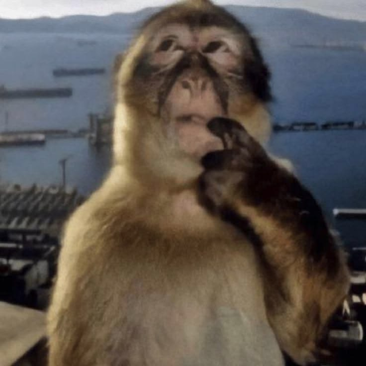
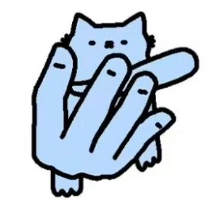
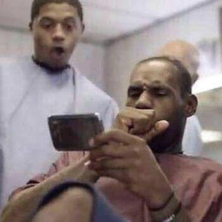
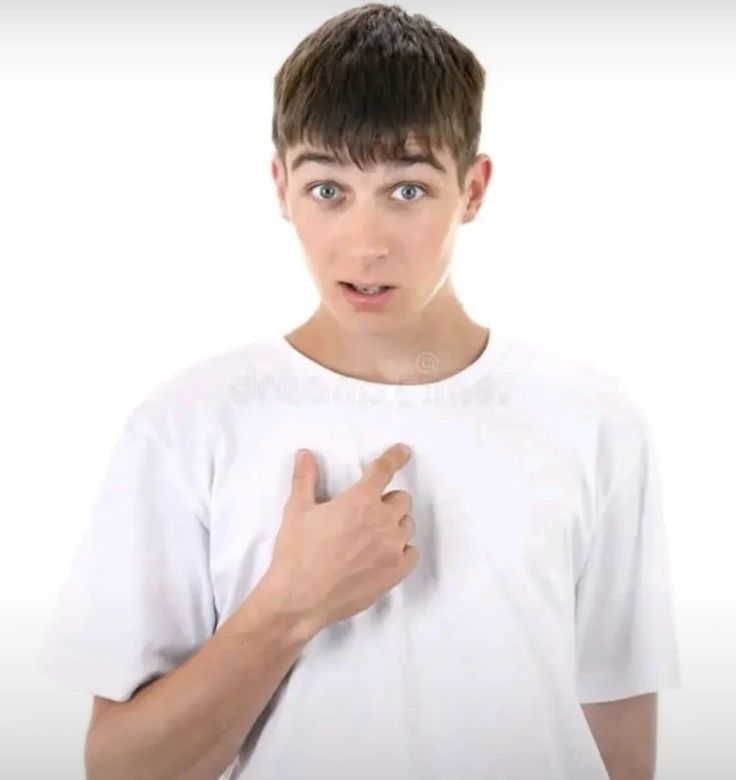

# 🎭 In-Video Hand Gesture & Meme Controller

The project includes an interactive gesture controller that maps your exact real-time hand poses and finger movements to meme reference images, rendering them directly inside the video window.

---

## 📸 Meme Reference Images & Exact Gesture Mapping

| ID | Meme Reference | Target Hand Pose | Handedness | Exact Pose Details |
| :---: | :---: | :--- | :---: | :--- |
| **1** |  | 🤙 **Cat Shaka** | **Left or Right** | **Thumb & Pinky extended outwards**, middle 3 fingers curled into palm ("Call-me" / Shaka sign). |
| **2** |  | ☝️ **Monkey Pointing** | **Left or Right** | **Index finger pointing straight UP**, thumb and other 3 fingers folded down. |
| **3** |  | 🤔 **Monkey Thinking** | **Left or Right** | **Index finger hooked/bent** (PIP joint forward, tip curled in towards chin in a thinking pose), other fingers folded. |
| **4** |  | 👍 **Monkey Thumbs Up** | **Left or Right** | **Thumb pointing vertically UP**, all four other fingers clenched tight in a fist. |
| **5** |  | ✊ **Laughing Baby Fist** | **Left Hand** *(or held fist)* | **Closed fist** with fingers clenched into a ball (matches the baby's left-hand fist in the meme). |
| **6** |  | 🔄 **LeBron Knuckle / Spin** | **Right Hand / Motion** | **Closed fist with Right Hand** (matches LeBron biting right knuckles) **OR drawing a circle in the air** (Clockwise / Counter Clockwise). |
| **7** |  | 🖐️ **J. Cole Open Hand** | **Left or Right** | **All 5 fingers extended flat out** facing the camera ("Stop / Wait / Chill" pose). |
| **8** |  | 👉👤 **Who, Me?** | **Left or Right** | **Index finger pointing horizontally inward at chest/self**, thumb extended out, other 3 fingers folded. |

---

## 🧠 System Architecture & Reliability Highlights

1. **100% In-Video Rendering**:
   - Zero external desktop windows spawned.
   - Clean, frosted-glass card rendered directly in the top-right corner of the OpenCV video window with smooth letterboxing.

2. **Hand-Agnostic Left & Right Hand Support**:
   - Kinematic analysis checks relative joint angles and bone chain vectors (`MCP` -> `PIP` -> `DIP` -> `TIP`) rather than hardcoded 2D x/y coordinates.
   - Works seamlessly regardless of whether you use your left hand or right hand, or show palm or back of hand.

3. **ML Keypoint Classifier Synergy**:
   - Closed fist detection integrates the pre-trained neural network (`KeyPointClassifier`) trained on thousands of hand samples, ensuring closed fists trigger reliably without missing curled thumbs.

4. **Hold-to-Confirm Temporal Smoothing**:
   - Requires you to hold a pose consistently for **8 frames (~0.25 - 0.30 seconds)** to lock it in.
   - Moving your hand or transitioning between poses will **never** trigger accidental memes.
   - An interactive cyan progress bar (`Holding: <Gesture> (XX%)`) provides real-time feedback while holding.

5. **Single-Hand Dual Access for Fists**:
   - Left Hand Fist -> Meme #5 (Baby).
   - Right Hand Fist -> Meme #6 (LeBron).
   - If using one hand only, holding the fist continuously for >1.5s smoothly toggles between Meme 5 and Meme 6!
